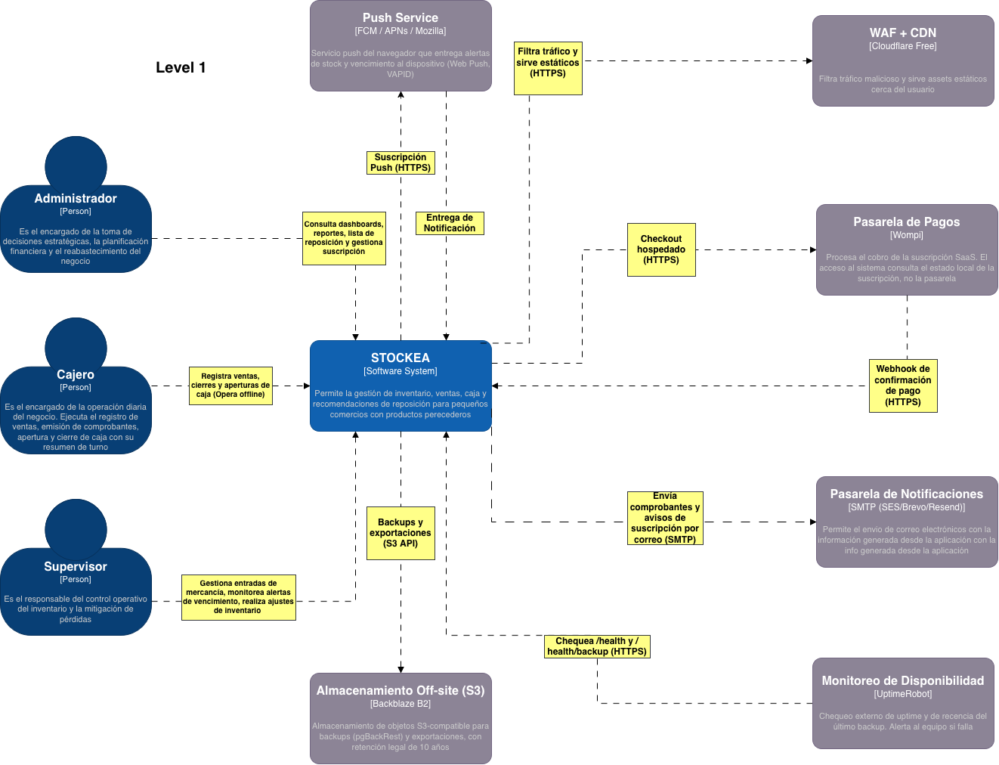

## 1. Nivel 1 — Contexto

### 1.1 Personas

|Persona|Responsabilidad|Interacción principal|
|---|---|---|
|**Cajero**|Operación diaria: registra ventas, cierres y aperturas de caja.|Usa el Frontend (PWA), **opera offline**.|
|**Supervisor**|Control operativo del inventario: entradas de mercancía, alertas de vencimiento, ajustes, resolución de discrepancias.|Usa el Frontend; resuelve la cola de discrepancias (ADR-002).|
|**Administrador**|Decisiones estratégicas: dashboards, reportes, lista de reposición y **gestión de la suscripción**.|Usa el Frontend; por roles acumulativos (ADR-005) puede hacer todo lo del Supervisor y el Cajero.|

Los tres roles son **acumulativos** (ADR-005): un único usuario Administrador puede operar una tienda de un solo empleado sin perder funcionalidad.

### 1.2 Sistemas externos 

|Sistema externo|Qué hace para STOCKEA|Por qué es externo|
|---|---|---|
|**Cloudflare (CDN/WAF)**|Filtra tráfico malicioso y sirve assets estáticos cerca del usuario.|Servicio gestionado; no se despliega.|
|**Pasarela de Pagos (Wompi)**|Procesa el cobro de la suscripción SaaS y confirma pagos por webhook.|Entidad financiera regulada; PCI fuera de alcance del equipo.|
|**Almacenamiento Off-site (S3)**|Guarda backups y exportaciones fuera del VPS (retención legal de 10 años, ADR-018).|Durabilidad e independencia del host que se respalda.|
|**Pasarela de Notificaciones (SMTP)**|Envía comprobantes y avisos de suscripción por correo.|Entregabilidad (SPF/DKIM/DMARC) delegada a un proveedor.|
|**Servicio Push del Navegador (FCM/APNs/Mozilla)**|Entrega notificaciones Web Push de alertas de stock/vencimiento.|Infraestructura de los navegadores/SO; no se autohospeda.|
|**Monitoreo externo (UptimeRobot)**|Chequea `/health` y `/health/backup`; alerta si el backup falla (ADR-014, ADR-016).|SaaS gratuito, independiente del VPS que vigila.|

> **Nota de cierre:** el **Proveedor de Identidad (IDP)** NO es un sistema externo en el MVP. La identidad la provee el propio Backend (Spring Security + `AuthPort`, ADR-010). Keycloak reaparece como sistema/contenedor solo si se activa en Fase 2.

---