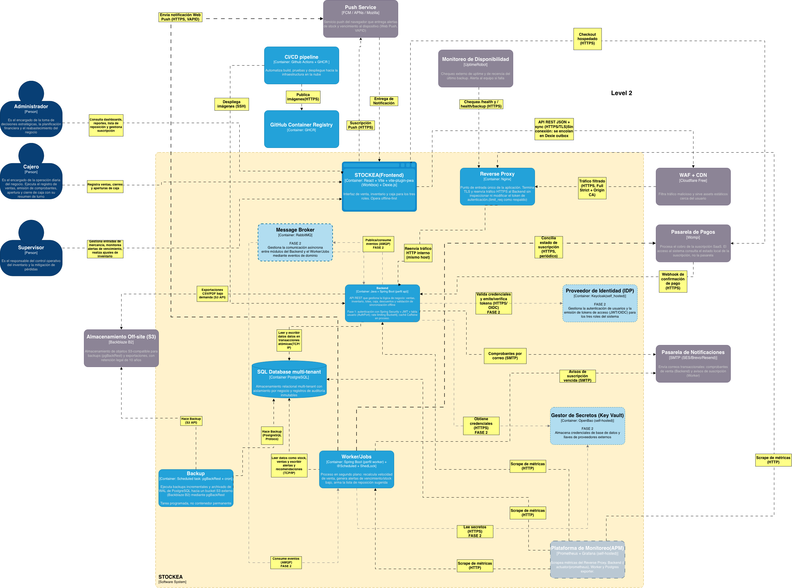

## 2. Nivel 2 — Contenedores 
### 2.1 Contenedores de Fase 1 (sólidos)

#### C1 — Frontend `[React + Vite + vite-plugin-pwa (Workbox) + Dexie.js]`

- **Responsabilidad:** interfaz de venta, inventario y caja para los tres roles. **Opera offline-first.** Genera los comprobantes PDF en el cliente.
- **Datos locales:** IndexedDB (vía Dexie) con el catálogo, lotes, ventas pendientes y turnos de caja; cola de outbox para sincronización.
- **Por qué React y no otra cosa:** es la única opción que se integra sin fricción con Workbox y Dexie.js (ya comprometidos en ADR-001); ecosistema maduro para PWA offline-first; mayor disponibilidad de ejemplos para el equipo. **Vue/Svelte:** compatibles pero el equipo no tiene experiencia previa. **Angular:** más pesado y ceremonioso de lo necesario para 3 personas. **Next.js:** orientado a SEO/SSR que esta app operativa interna no necesita, y el SSR complica la integración del Service Worker.

#### C2 — Reverse Proxy `[Nginx]`

- **Responsabilidad:** punto de entrada único. Termina TLS y reenvía tráfico HTTP interno al Backend **sin inspeccionar ni modificar el token** (ADR-007). Respaldo de rate limiting con `limit_req` si Cloudflare cae (ADR-013).
- **Por qué Nginx y no otro:** estándar maduro, bajísimo consumo, documentación abundante. **Traefik/Caddy:** válidos (TLS automático), pero Nginx es el más conocido por el equipo y suficiente. **HAProxy:** orientado a balanceo L4/L7 avanzado, innecesario para una sola instancia.

#### C3 — Backend API `[Java + Spring Boot, perfil api]`

- **Responsabilidad:** lógica de negocio (ventas, inventario, lotes, caja, descuentos), validación de sincronización offline, autenticación (`AuthPort`), autorización por rol, rate limiting (Bucket4j), reasignación FEFO y resolución de discrepancias.
- **Caché:** **Caffeine en proceso** (ADR-019), detrás del puerto de repositorio. No es un contenedor.
- **Por qué Java + Spring Boot:** formaliza lo que ADR-004/005/009 ya asumían (Spring Security, Spring Data); un solo lenguaje para API y Worker. **Node/NestJS:** mismo lenguaje que el front, pero sin equivalentes tan maduros a Spring Security (RBAC jerárquico) y Spring Data (Unit of Work transaccional). **Kotlin+Ktor / Go:** más livianos pero reabren decisiones ya cerradas y suben el riesgo para un equipo de 3. **.NET:** maduro, pero ningún ADR previo lo referencia; adoptarlo obligaría a reescribir justificaciones.

#### C4 — Worker/Jobs `[Java + Spring Boot, perfil worker]`

- **Responsabilidad:** procesos en segundo plano: recalcula velocidad de venta, genera alertas de vencimiento/stock bajo, arma la lista de reposición (ADR-006) y concilia la suscripción (ADR-015).
- **Despliegue:** **mismo JAR** que el Backend con perfil `worker`; usa **ShedLock** para no duplicar ejecución (ADR-011).
- **Por qué separado del Backend:** aislamiento de fallos (ESC-CAL-DIS-0029). Un recálculo pesado no debe degradar la API de venta. **Por qué mismo JAR:** evita mantener dos ecosistemas para un proceso funcionalmente simple.

#### C5 — PostgreSQL `[Base de datos multi-tenant]`

- **Responsabilidad:** almacenamiento relacional con **aislamiento por negocio** (`negocio_id` + Row-Level Security) y registros de auditoría **inmutables** (ADR-004).
- **Por qué PostgreSQL:** RLS nativo (clave para el multi-tenant barato), transacciones ACID, madurez, gratuito. **MySQL:** sin RLS tan robusto. **MongoDB:** sin transacciones cross-documento igual de simples ni RLS; el dominio es relacional (ventas, lotes, items). **CockroachDB:** distribución que no se necesita a esta escala y cuesta más RAM.
- **Por qué discriminador + RLS y no schema/DB por tenant:** con el presupuesto de USD 50/mes por 100 negocios, una DB o schema por tenant multiplica el costo operativo. El discriminador + RLS da aislamiento lógico con una sola instancia; RLS actúa como red de seguridad si el filtro de aplicación falla.

#### C6 — Monitoring `[Prometheus + Grafana self-hosted]`

- **Responsabilidad:** observa métricas del Reverse Proxy, Backend, Worker y Postgres exporter (ADR-016). MDC con `negocio_id`, `usuario_id`, `dispositivo_id`, `operacion_id`.
- **Por qué Prometheus + Grafana:** estándar de facto, ambos OSI, costo cero. **Datadog/New Relic:** rompen el presupuesto. **Grafana Cloud:** opción para ahorrar RAM si el self-hosted pesa.
- **Alertas en MVP:** **UptimeRobot** (sistema externo; incluye alerta de backup fallido). **Alertmanager** se difiere a Fase 2. Prometheus scrapea por HTTP interno y Grafana no se expone públicamente (ADR-013).

#### Backup (tarea programada, no contenedor) `[pgBackRest + cron]`

- **Responsabilidad:** WAL archiving + PITR de PostgreSQL hacia el bucket S3 externo (ADR-014).
- **Por qué pgBackRest y no Restic además:** pgBackRest cubre PostgreSQL con PITR; al eliminar MinIO ya no hay almacén de archivos que respaldar con Restic, así que **se deja solo pgBackRest** para no duplicar herramientas. **Barman/WAL-G/pg_dump:** válidos, pero pgBackRest ofrece PITR + archivado incremental con configuración simple.

### 2.2 Contenedores diferidos a Fase 2 (punteados, etiqueta "Fase 2")

|Contenedor|Tecnología|Disparador de activación|¿Dibujado en N2?|
|---|---|---|---|
|Message Broker|RabbitMQ|>1 instancia de Backend o integraciones asíncronas (ADR-008).|Sí|
|Proveedor de Identidad|Keycloak|SSO, MFA o federación (ADR-010).|Sí|
|Gestor de Secretos|OpenBao|>1 host o rotación exigida de credenciales (ADR-010). En MVP: Docker secrets + SOPS/age.|Sí|
|Caché distribuida|Valkey|>1 instancia de Backend o latencia medida (ADR-019).|No (solo ADR-012)|
|Object Storage propio|Garage / SeaweedFS|Necesidad real de archivos que no sean backups (ADR-020).|No (solo ADR-012)|
|Alertas|Alertmanager|>1 servicio con alertas proactivas (ADR-016).|No (solo ADR-012)|

> **Por qué diferidos y no eliminados:** siguen siendo la arquitectura objetivo. Dibujarlos punteados defiende la arquitectura completa (lo que se evalúa) sin contradecir que el MVP arranca liviano. **RabbitMQ, Redis(→Valkey) y Keycloak están en las notas de clase y en el Nivel 1 original**, por eso se conservan en el diagrama como objetivo, no se borran.

### 2.3 Relaciones del Nivel 2 (origen → destino : propósito [protocolo])

**Personas → sistema**

- Cajero → Frontend : registra ventas, cierres y aperturas de caja (opera offline).
- Supervisor → Frontend : gestiona mercancía, alertas y resuelve discrepancias.
- Administrador → Frontend : consulta dashboards/reportes y gestiona la suscripción.

**Borde y entrada**

- Frontend → Cloudflare : API REST JSON y sincronización [HTTPS/TLS]; sin conexión las operaciones **se encolan en la outbox de Dexie**.
    
- Cloudflare → Reverse Proxy : tráfico filtrado [HTTPS, Full (strict) + Origin CA] (ADR-013).
    
- Reverse Proxy → Backend : reenvía tráfico descifrado [HTTP interno, misma máquina].
    

**Núcleo de negocio**

- Backend → PostgreSQL : lee y escribe datos filtrados por negocio, en transacciones atómicas [TCP/IP].
- Worker → PostgreSQL : lee stock/ventas/vencimientos y escribe alertas y recomendaciones [TCP/IP].
- Backend ↔ Worker : **no hay comunicación directa** (ni HTTP ni eventos). Se coordinan solo a través de PostgreSQL (alertas, recomendaciones, outbox). Los eventos de dominio de Spring Modulith viven dentro del proceso del Backend (ADR-011 v4).

**Suscripción y pagos (ADR-015)**

- Frontend → Wompi : checkout hospedado [HTTPS].
- Wompi → Backend : webhook firmado de confirmación de pago [HTTPS].
- **Worker → Wompi : concilia el estado de la suscripción [HTTPS, periódico].**
- Backend → PostgreSQL : actualiza `suscripcion`; **el acceso solo consulta el estado local** (no valida contra Wompi en cada acceso).

**Almacenamiento off-site (ADR-014, ADR-020)**

- Backup (pgBackRest) → S3 : backups [S3 API]. Retención **10 años** (ADR-018).
- Backend → S3 : exportaciones CSV/PDF bajo demanda [S3 API]. Los comprobantes no se almacenan: se generan en el cliente y se regeneran desde la BD (ADR-020).

**Notificaciones (ADR-017)**

- Backend → Pasarela SMTP : comprobantes por correo [SMTP].
- Worker → Pasarela SMTP : avisos de suscripción vencida [SMTP]. Las alertas de stock y vencimiento no van por correo (ADR-017).
- Frontend → Servicio Push : suscripción push [HTTPS].
- Servicio Push → Frontend : entrega de notificación.
- **Worker → Servicio Push : notificación Web Push de alertas [HTTPS, VAPID].**

**Observabilidad (ADR-016)**

- Prometheus → Reverse Proxy, Backend (`/actuator/prometheus`), Worker, Postgres exporter : scrape de métricas [HTTP interno].
- UptimeRobot → Reverse Proxy : chequea `/health` y `/health/backup` [HTTPS].

**CI/CD**

- GitHub Actions → GHCR : publica imágenes [HTTPS]. GitHub Actions → VPS : despliega imágenes [SSH].

**Secretos (según fase)**

- MVP: Backend lee secretos de Docker secrets/SOPS en arranque.
- Fase 2: Backend → OpenBao : obtiene credenciales [HTTPS].

