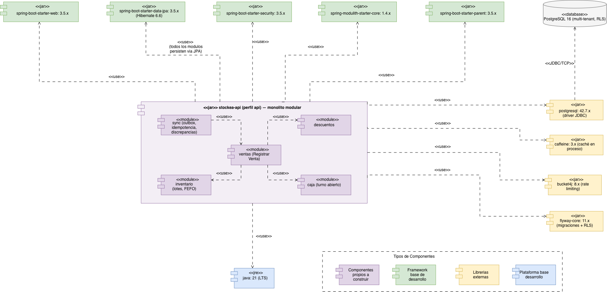
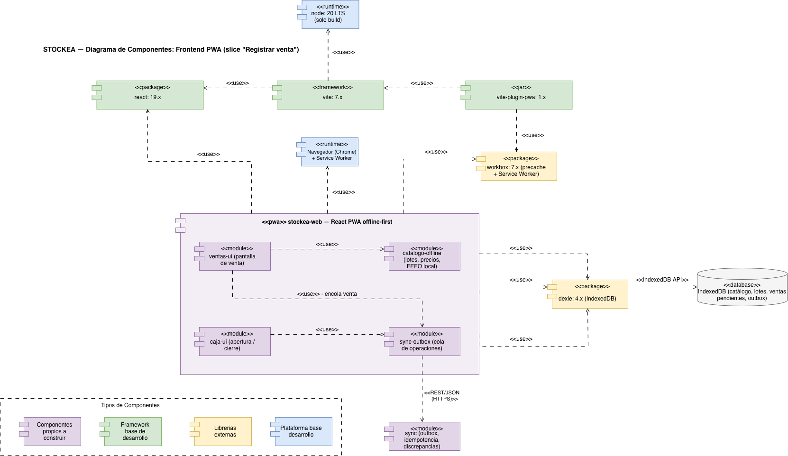

Dos diagramas, uno por contenedor, porque backend y frontend tienen ciclos de vida distintos. Muestran los módulos propios a construir y las librerías de las que dependen, con su versión.

## Backend — `stockea-api`

| Módulo | Responsabilidad en este slice |
|---|---|
| `ventas` | Arma `Venta`, `ItemVenta` y `AsignacionLote`, calcula totales y decide el estado |
| `inventario` | Lotes y FEFO: consulta y bloquea lotes, descuenta stock, resuelve el precio vigente |
| `descuentos` | Descuento vigente por lote y por producto |
| `caja` | Turno abierto del cajero |
| `sync` | Idempotencia, `operacion_sync` y discrepancias |

Plataforma y librerías: Java 21 LTS, `spring-boot-starter-web` y `-security` 3.5.x, `spring-modulith-starter-core` 1.4.x, `bucket4j` 8.x, `caffeine` 3.x y el driver `postgresql` 42.7.x. No son decorativas: Modulith es lo que hace cumplir las fronteras entre módulos (ADR-011), Bucket4j implementa el rate limiting que se decidió no delegar a un gateway (ADR-007) y Caffeine es la caché del MVP (ADR-019).

## Frontend — `stockea-web`

| Módulo | Responsabilidad |
|---|---|
| `ventas-ui` | Pantalla de venta |
| `caja-ui` | Apertura y cierre de turno |
| `catalogo-offline` | Lotes, precios y **FEFO local** sobre Dexie |
| `sync-outbox` | Cola de operaciones y **único** punto que llama al backend |

Plataforma y librerías: React 19.x, Vite 7.x, `vite-plugin-pwa` 1.x, `dexie` 4.x y Node 20 **solo para build** (no se despliega).

## Decisiones clave

- **El FEFO existe dos veces, a propósito.** `catalogo-offline` lo ejecuta localmente para poder cobrar sin conexión; `inventario` lo rehace en el servidor sobre el stock real, y el del servidor manda (ADR-002, ADR-003).
- **`sync-outbox` es el único módulo del frontend que conoce la red.** Ni la pantalla de venta ni el catálogo llaman al backend (ADR-001).
- **Comunicación entre contenedores:** `<<REST/JSON (HTTPS)>>` del frontend al backend, `<<IndexedDB API>>` del frontend a su base local, `<<JDBC/TCP>>` del backend a PostgreSQL.
