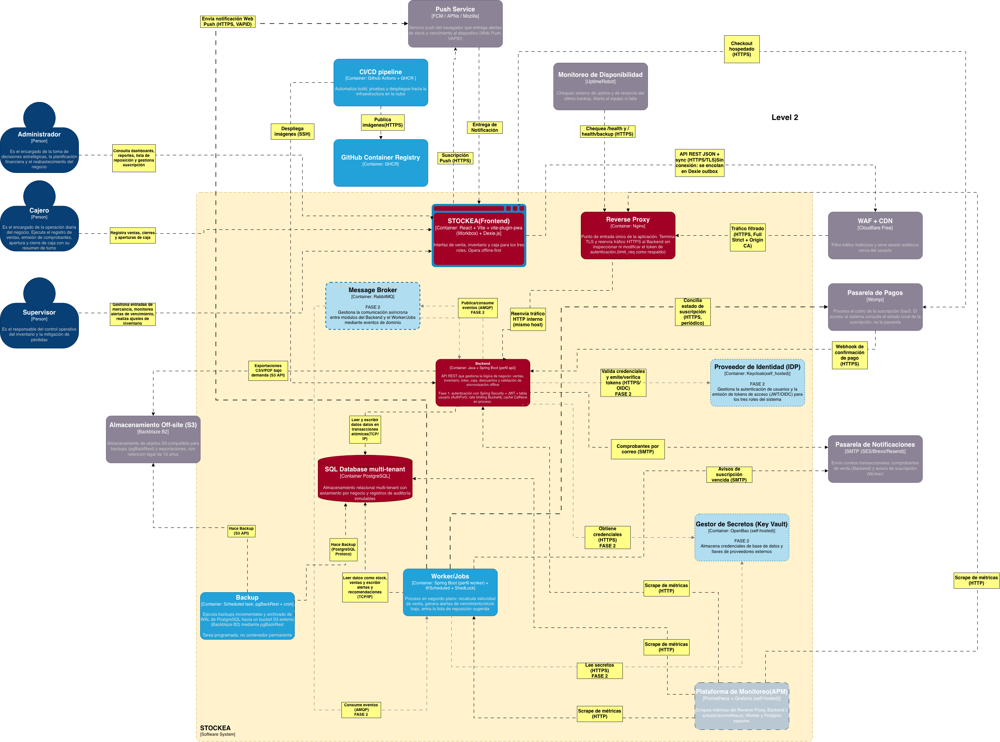

Seis contenedores de Fase 1 más el backup como tarea programada. Los contenedores punteados con etiqueta "Fase 2" son arquitectura objetivo, no MVP (ADR-012).

## Contenedores de Fase 1

| # | Contenedor | Tecnología | Responsabilidad |
|---|---|---|---|
| C1 | **Frontend** | React + Vite + vite-plugin-pwa (Workbox) + Dexie.js | Interfaz de venta, inventario y caja para los tres roles. **Opera offline-first** con IndexedDB (catálogo, lotes, ventas pendientes, outbox). Genera los comprobantes PDF en el cliente |
| C2 | **Reverse Proxy** | Nginx | Punto de entrada único. Termina TLS y reenvía al Backend **sin inspeccionar el token** (ADR-007). Respaldo de rate limiting con `limit_req` si Cloudflare cae |
| C3 | **Backend API** | Java 21 + Spring Boot, perfil `api` | Lógica de negocio (ventas, inventario, lotes, caja, descuentos), validación de sincronización, autenticación y autorización, rate limiting con Bucket4j, FEFO y discrepancias. Caché Caffeine **en proceso**, no es contenedor |
| C4 | **Worker/Jobs** | Java + Spring Boot, perfil `worker` | Procesos en segundo plano: velocidad de venta, alertas de vencimiento y stock bajo, lista de reposición (ADR-006) y conciliación de suscripción (ADR-015). **Mismo JAR** que el Backend, con ShedLock |
| C5 | **PostgreSQL** | Base de datos multi-tenant | Almacenamiento con aislamiento por `negocio_id` + Row-Level Security y registros de auditoría inmutables (ADR-004) |
| C6 | **Monitoring** | Prometheus + Grafana self-hosted | Métricas del proxy, Backend, Worker y Postgres exporter. MDC con `negocio_id`, `usuario_id`, `dispositivo_id`, `operacion_id` |
| — | **Backup** (tarea programada) | pgBackRest + cron | WAL archiving y PITR hacia el bucket S3 externo (ADR-014) |

## Decisiones que explican el diagrama

- **Worker separado del Backend, pero mismo JAR.** Separado por aislamiento de fallos: un recálculo pesado no debe degradar la API de venta. Mismo JAR para no mantener dos ecosistemas.
- **PostgreSQL con discriminador + RLS, no una base por negocio.** Con el techo de USD 50 por 100 negocios, una base o esquema por inquilino multiplica el costo operativo. RLS actúa como red de seguridad si el filtro de aplicación falla.
- **Sin contenedor de caché ni de identidad.** Caffeine y Spring Security viven dentro del JAR (ADR-010, ADR-019).

## Diferidos a Fase 2

| Contenedor | Disparador | ¿Dibujado? |
|---|---|---|
| RabbitMQ | Más de 1 instancia de Backend o integraciones asíncronas | Sí, punteado |
| Keycloak | SSO, MFA o federación | Sí, punteado |
| OpenBao | Más de un host o rotación exigida de credenciales | Sí, punteado |
| Valkey | Más de 1 instancia de Backend o latencia medida | No, solo en ADR-012 |
| Garage / SeaweedFS | Necesidad real de archivos que no sean backups | No, solo en ADR-012 |
| Alertmanager | Más de 1 servicio con alertas proactivas | No, solo en ADR-012 |
