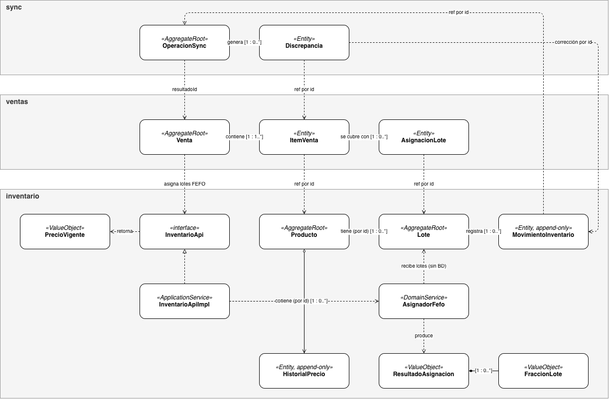

# Modelo de dominio — slice "Registrar venta"

Clases del dominio, agregados y dónde vive cada regla, antes de hablar de tablas. Los `namespace` corresponden a los módulos de Spring Modulith; los estereotipos distinguen raíces de agregado, entidades, objetos de valor y servicios de dominio.

## Las cuatro decisiones

**1. Referencias por ID entre agregados.** `ItemVenta` guarda `productoId`, no un objeto `Producto`. Cruzar módulos por referencia de objeto crearía un grafo que arrastra medio esquema en cada carga y rompería la frontera de Modulith (ADR-011).

**2. Un `ItemVenta` con varias `AsignacionLote`.** El cliente compra "10 unidades del producto P" a un precio; que salgan de dos lotes es un detalle de inventario. Con varias líneas habría que prorratear precio y descuento, y el comprobante mostraría el mismo producto repetido (ADR-003).

**3. `AsignadorFefo` es dominio puro.** Recibe la lista de lotes ya bloqueada y la cantidad, y devuelve el reparto. No consulta ni escribe: quien habla con la base de datos es `InventarioApiImpl`. Así el algoritmo más importante del sistema se prueba con una lista en memoria, sin levantar PostgreSQL (ADR-009).

**4. `descuentoSinCobertura` separado.** El descuento de las unidades que ningún lote cubrió no tiene lote al cual atarse, así que vive en `ItemVenta` y no en `AsignacionLote`. Sin ese campo el total de línea no cuadraría cuando hay discrepancia de stock (ADR-002, ADR-003).

## Invariantes

- `SUM(asignacion.cantidad) + cantidadSinCobertura = item.cantidad`, por línea.
- `descuentoTotalLinea = SUM(asignacion.montoDescuento) + descuentoSinCobertura`.
- `lote.cantidadDisponible >= 0`, siempre.
- Una `Venta` registrada no se modifica: las correcciones son registros nuevos (ADR-004).

#### Módulo ventas

**Venta** (AggregateRoot, inmutable)

|Atributo|Tipo|Visibilidad|Descripción|
|---|---|---|---|
|id|UUID|privado|Identificador de la venta|
|negocioId|UUID|privado|Negocio (tenant) al que pertenece|
|operacionId|UUID|privado|Referencia a la `OperacionSync` que la originó|
|dispositivoId|UUID|privado|Dispositivo POS que la registró|
|cajeroId|UUID|privado|Usuario cajero|
|turnoCajaId|UUID|privado|Turno de caja en el que se registró|
|estado|EstadoVenta|privado|ACEPTADA, REASIGNADA o DISCREPANCIA|
|metodoPago|MetodoPago|privado|Forma de pago|
|subtotal|BigDecimal|privado|Suma de subtotales de ítems|
|descuentoTotal|BigDecimal|privado|Descuento total aplicado|
|total|BigDecimal|privado|Valor final cobrado|
|montoRecibido|BigDecimal|privado|Dinero entregado por el cliente|
|cambio|BigDecimal|privado|Vuelto entregado|
|fechaCliente|Instant|privado|Fecha/hora en el dispositivo (offline)|
|registradaEn|Instant|privado|Fecha/hora de registro en el servidor|

**ItemVenta** (Entity, inmutable)

|Atributo|Tipo|Visibilidad|Descripción|
|---|---|---|---|
|id|UUID|privado|Identificador del ítem|
|productoId|UUID|privado|Referencia a `Producto`|
|cantidad|BigDecimal|privado|Cantidad vendida|
|precioUnitario|BigDecimal|privado|Precio cobrado por unidad|
|descuentoTotalLinea|BigDecimal|privado|Descuento total de la línea|
|descuentoSinCobertura|BigDecimal|privado|Descuento sin lote asignado|
|subtotal|BigDecimal|privado|Subtotal de la línea|
|cantidadSinCobertura|BigDecimal|privado|Cantidad que ningún lote pudo cubrir|

**AsignacionLote** (Entity, inmutable)

|Atributo|Tipo|Visibilidad|Descripción|
|---|---|---|---|
|id|UUID|privado|Identificador de la asignación|
|loteId|UUID|privado|Referencia a `Lote`|
|cantidad|BigDecimal|privado|Cantidad descontada de ese lote|
|descuentoId|UUID|privado|Descuento aplicado (si existe)|
|montoDescuento|BigDecimal|privado|Monto del descuento en esta fracción|
|origen|OrigenAsignacion|privado|DISPOSITIVO o REASIGNACION_FEFO|

**Enumeraciones**

|Enum|Valores|
|---|---|
|EstadoVenta|ACEPTADA, REASIGNADA, DISCREPANCIA|
|MetodoPago|EFECTIVO, TRANSFERENCIA, TARJETA|
|OrigenAsignacion|DISPOSITIVO, REASIGNACION_FEFO|

**Operaciones clave:** `Venta.registrar(cmd, asignaciones)` (factory estática), `Venta.items()`, `ItemVenta.tieneDiscrepancia()`.

---

#### Módulo inventario

**Producto** (AggregateRoot)

|Atributo|Tipo|Visibilidad|Descripción|
|---|---|---|---|
|id|UUID|privado|Identificador del producto|
|negocioId|UUID|privado|Negocio propietario|
|nombre|String|privado|Nombre comercial|
|categoria|String|privado|Categoría|
|unidadVenta|UnidadVenta|privado|UNIDAD, KILOGRAMO o LIBRA|
|precioVenta|BigDecimal|privado|Precio de venta actual|
|stockMinimo|BigDecimal|privado|Umbral de alerta de stock|
|activo|boolean|privado|Si se puede vender|

**Lote** (AggregateRoot)

| Atributo           | Tipo       | Visibilidad | Descripción                                    |
| ------------------ | ---------- | ----------- | ---------------------------------------------- |
| id                 | UUID       | privado     | Identificador del lote                         |
| negocioId          | UUID       | privado     | Negocio propietario                            |
| productoId         | UUID       | privado     | Referencia a `Producto`                        |
| fechaVencimiento   | LocalDate  | privado     | Fecha calendario (America/Bogota)              |
| cantidadInicial    | BigDecimal | privado     | Cantidad al ingresar                           |
| cantidadDisponible | BigDecimal | privado     | Existencias actuales                           |
| costoUnitario      | BigDecimal | privado     | Costo por unidad                               |
| estado             | EstadoLote | privado     | ACTIVO, AGOTADO o VENCIDO                      |

**HistorialPrecio** (Entity, append-only)

|Atributo|Tipo|Visibilidad|Descripción|
|---|---|---|---|
|id|UUID|privado|Identificador del registro|
|productoId|UUID|privado|Referencia a `Producto`|
|precioVenta|BigDecimal|privado|Precio establecido|
|vigenteDesde|Instant|privado|Inicio de vigencia|
|creadoEn|Instant|privado|Fecha de creación del registro|
|creadoPor|UUID|privado|Usuario que lo creó|

**MovimientoInventario** (Entity, append-only)

|Atributo|Tipo|Visibilidad|Descripción|
|---|---|---|---|
|id|UUID|privado|Identificador del movimiento|
|loteId|UUID|privado|Referencia a `Lote`|
|tipo|TipoMovimiento|privado|ENTRADA, VENTA o CORRECCION|
|cantidad|BigDecimal|privado|Cantidad movida|
|operacionId|UUID|privado|Referencia a `OperacionSync`|
|discrepanciaId|UUID|privado|Discrepancia que corrige (si aplica)|
|creadoEn|Instant|privado|Fecha de creación|
|creadoPor|UUID|privado|Usuario o proceso que lo generó|

**ResultadoAsignacion** (ValueObject)

|Atributo|Tipo|Visibilidad|Descripción|
|---|---|---|---|
|fracciones|List<FraccionLote>|público|Fracciones asignadas por lote|
|sinCobertura|BigDecimal|público|Cantidad que no se pudo cubrir|

**FraccionLote** (ValueObject)

|Atributo|Tipo|Visibilidad|Descripción|
|---|---|---|---|
|loteId|UUID|público|Lote asignado|
|cantidad|BigDecimal|público|Cantidad tomada del lote|

**PrecioVigente** (ValueObject)

|Atributo|Tipo|Visibilidad|Descripción|
|---|---|---|---|
|precio|BigDecimal|público|Precio vigente a la fecha consultada|
|activo|boolean|público|Si el producto está activo|

**Enumeraciones**

|Enum|Valores|
|---|---|
|EstadoLote|ACTIVO, AGOTADO, VENCIDO|
|TipoMovimiento|ENTRADA, VENTA, CORRECCION|
|UnidadVenta|UNIDAD, KILOGRAMO, LIBRA|

**Operaciones clave:** `InventarioApi.precioVigente(productoId, fecha)`, `InventarioApi.asignarFefo(productoId, cantidad, fecha, operacionId)`, `AsignadorFefo.asignar(lotes, cantidad)` (puro, sin acceso a BD), `Lote.descontar(cantidad)`.

---

#### Módulo sync

**OperacionSync** (AggregateRoot, inmutable, PK compuesta `negocioId` + `operacionId`)

|Atributo|Tipo|Visibilidad|Descripción|
|---|---|---|---|
|negocioId|UUID|privado|PK parte 1: negocio|
|operacionId|UUID|privado|PK parte 2: id de la operación (idempotencia)|
|dispositivoId|UUID|privado|Dispositivo origen|
|usuarioId|UUID|privado|Usuario que ejecutó la operación|
|tipo|TipoOperacion|privado|Tipo de operación (hoy: VENTA)|
|secuenciaDispositivo|long|privado|Orden secuencial en el dispositivo|
|estado|EstadoOperacion|privado|Resultado del procesamiento|
|payload|String|privado|Contenido original de la operación|
|creadaEnCliente|Instant|privado|Fecha/hora de creación en el dispositivo|
|recibidaEn|Instant|privado|Fecha/hora de recepción en el servidor|
|procesadaEn|Instant|privado|Fecha/hora de procesamiento|
|resultadoId|UUID|privado|Referencia a la `Venta` resultante|

**Discrepancia** (Entity)

|Atributo|Tipo|Visibilidad|Descripción|
|---|---|---|---|
|id|UUID|privado|Identificador de la discrepancia|
|negocioId|UUID|privado|Negocio|
|operacionId|UUID|privado|Referencia a `OperacionSync` que la generó|
|ventaId|UUID|privado|Referencia a la `Venta`|
|itemVentaId|UUID|privado|Referencia al `ItemVenta` afectado|
|productoId|UUID|privado|Referencia a `Producto`|
|loteId|UUID|privado|Referencia a `Lote` involucrado|
|motivo|MotivoDiscrepancia|privado|Causa de la discrepancia|
|cantidadFaltante|BigDecimal|privado|Cantidad no cubierta|
|precioCobrado|BigDecimal|privado|Precio cobrado en el dispositivo|
|precioEsperado|BigDecimal|privado|Precio vigente según servidor|
|estado|EstadoDiscrepancia|privado|ABIERTA o RESUELTA|
|detectadaEn|Instant|privado|Fecha de detección|
|resueltaPor|UUID|privado|Usuario que la resolvió|
|resueltaEn|Instant|privado|Fecha de resolución|
|movimientoCorreccionId|UUID|privado|Referencia al `MovimientoInventario` de corrección|

**Enumeraciones**

|Enum|Valores|
|---|---|
|EstadoOperacion|ACEPTADA, REASIGNADA, DISCREPANCIA, RECHAZADA_POR_PERMISOS, RECHAZADA_SIN_TURNO|
|TipoOperacion|VENTA|
|MotivoDiscrepancia|STOCK_INSUFICIENTE, SIN_LOTE_DISPONIBLE, LOTE_VENCIDO, PRODUCTO_INACTIVO, PRECIO_DIFERENTE|
|EstadoDiscrepancia|ABIERTA, RESUELTA|

**Operaciones clave:** `Discrepancia.resolver(usuarioId, movimientoId)`.