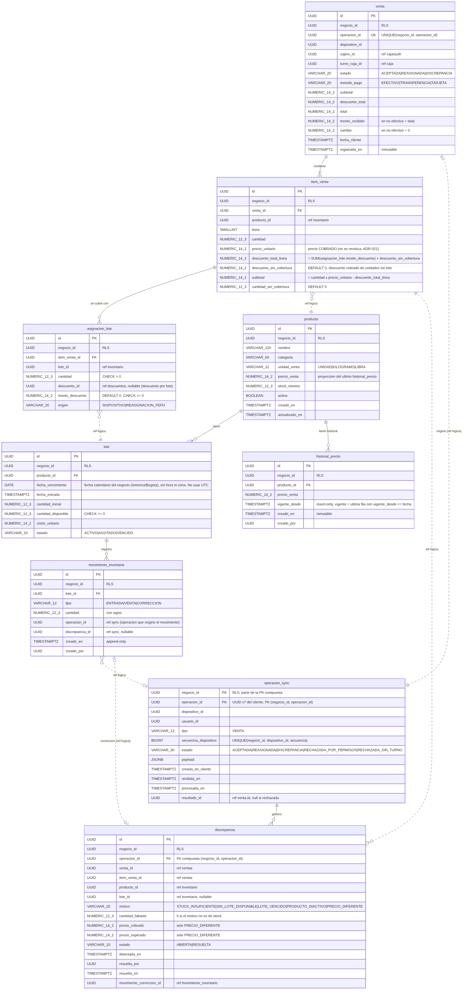

# Modelo entidad-relación — slice "Registrar venta"

Esquema físico en PostgreSQL. Las relaciones con línea continua son claves foráneas reales, dentro del mismo módulo; las punteadas son referencias por identificador entre módulos, **sin FK**, para que el esquema respete las mismas fronteras que el código (ADR-011).

## Las cuatro decisiones

**1. PK compuesta `(negocio_id, operacion_id)` en `operacion_sync`.** Un reenvío de la misma operación choca contra la clave primaria en lugar de crear una venta duplicada. El `operacion_id` es un UUID v7 generado en el **cliente**, porque el cliente es quien sabe que es la misma operación. Antes de procesar se toma además un `pg_advisory_xact_lock` sobre el hash de esa pareja, que serializa reintentos concurrentes (ADR-002).

**2. `cantidad_sin_cobertura` en `item_venta`.** Lo que ningún lote cubrió no desaparece ni empuja el stock a negativo: se registra en la línea, con su `descuento_sin_cobertura`, y genera una fila en `discrepancia`. `lote.cantidad_disponible` tiene `CHECK >= 0` (ADR-002).

**3. `lote.fecha_vencimiento` es `DATE`, no `TIMESTAMPTZ`.** Un vencimiento es una fecha calendario del negocio en `America/Bogota`; guardarlo como instante lo haría cambiar de día según la zona del servidor. Los instantes técnicos (`registrada_en`, `vigente_desde`) sí son `TIMESTAMPTZ` (ADR-023).

**4. `negocio_id` en todas las tablas, con Row-Level Security.** La aplicación fija `SET LOCAL app.negocio_id` al abrir la transacción y PostgreSQL filtra cada tabla: aunque una consulta olvide el filtro, la base de datos no devuelve filas de otro negocio. La columna está también en las tablas hijas para que la política se aplique sin joins (ADR-009).

## Tablas

| Tabla | Razón de ser |
|---|---|
| `venta` | Cabecera: totales, método de pago, `fecha_cliente` y estado |
| `item_venta` | Una línea por producto, con el **precio cobrado** y el descuento total de la línea |
| `asignacion_lote` | De qué lote salió cada fracción y con qué descuento |
| `producto` / `lote` | Catálogo e inventario |
| `historial_precio` | Qué precio estaba vigente en una fecha. Insert-only (ADR-021) |
| `movimiento_inventario` | Bitácora append-only de todo cambio de stock |
| `operacion_sync` | Idempotencia y resultado por operación |
| `discrepancia` | Lo que no cuadró: stock, producto inactivo o precio |

Dinero en `NUMERIC(14,2)` y cantidades en `NUMERIC(12,3)`, que admiten venta por peso. Nunca `float`: acumula error y la caja no cuadra.
