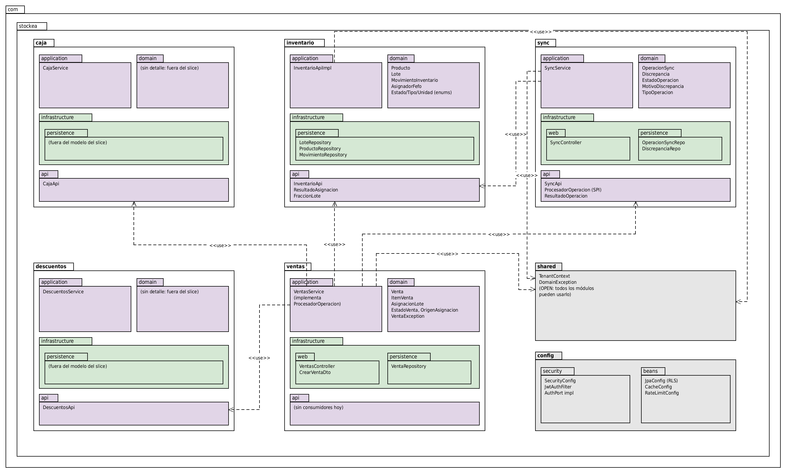

# Diagrama de paquetes — Backend (`com.stockea`)

Cada carpeta grande es un módulo de Spring Modulith (`ventas`, `inventario`, `sync`, `caja`, `descuentos`, más `shared` y `config`); dentro, las capas `domain`, `application`, `infrastructure` y `api`. Morado es núcleo de negocio, verde infraestructura, gris transversal.

## Reglas de dependencia

1. **Un módulo solo puede depender de la `api` de otro.** Se declara con `@NamedInterface("api")` en `package-info.java` y **se verifica en una prueba** con `ApplicationModules.of(...).verify()`, que falla el build si alguien la viola o crea un ciclo.
2. Dentro del módulo: **`infrastructure → application → domain`**. `domain` no depende de nada; `application` implementa las interfaces de `api`.
3. `shared` (`TenantContext`, `DomainException`) es abierto y no contiene reglas de negocio. `config` solo tiene beans.

## Dependencias dibujadas

| Origen | Destino | Para qué |
|---|---|---|
| `ventas.application` | `inventario.api` | `asignarFefo()`, `precioVigente()` |
| `ventas.application` | `caja.api` | validar turno abierto |
| `ventas.application` | `descuentos.api` | descuento vigente por lote |
| `ventas.application` | `sync.api` | implementar `ProcesadorOperacion` y registrar `operacion_sync` |
| `sync.application` | `inventario.api` | movimiento `CORRECCION` al resolver una discrepancia |
| `ventas` / `inventario` / `sync` `.application` | `shared` | `TenantContext` con el `negocio_id` |

## Decisiones clave

- **`sync` no depende de `ventas`.** Sería un ciclo: `ventas` necesita registrar la operación y `sync` necesita procesarla. Se rompe por inversión de dependencia: `sync.api` **define** `ProcesadorOperacion` y `ventas` la implementa (ADR-011).
- **`ventas.api` está vacía.** Nadie necesita llamar a ventas desde otro módulo; exponer una `api` por simetría invitaría a acoplamientos que hoy no existen.
- **La transacción la abre `application`, no el repositorio.** `@Transactional` en `VentasService` y `SyncService` cubre venta, asignaciones, descuento de stock y `operacion_sync` en un solo `COMMIT` (ADR-009).
