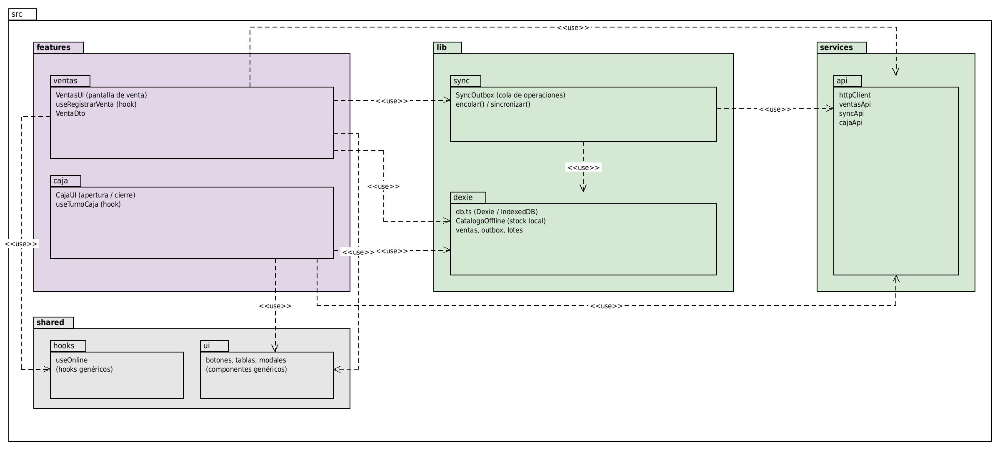

# Diagrama de paquetes — Frontend (`src/`)

Morado es funcionalidad de negocio (`features/ventas`, `features/caja`), verde infraestructura offline (`lib/dexie`, `lib/sync`, `services/api`), gris transversal (`shared/ui`, `shared/hooks`).

## Regla de dependencia

Las dependencias van en un solo sentido: **`features → lib → services`**. Nunca al revés, y **nunca entre features**: `ventas` y `caja` no se llaman entre sí. Lo que ambas necesitan vive en `shared` o en `lib`.

| Origen | Destino | Para qué |
|---|---|---|
| `features/ventas` | `lib/dexie` | leer catálogo local y descontar stock con FEFO local |
| `features/ventas` | `lib/sync` | encolar la operación |
| `features/ventas` | `shared/ui`, `shared/hooks` | componentes y `useOnline` |
| `features/caja` | `lib/dexie`, `shared/ui` | turno local y componentes |
| `lib/sync` | `services/api` | único punto que hace REST |

## Decisiones clave

- **`services/api` es el único lugar con llamadas REST, y solo `lib/sync` lo usa.** Ninguna pantalla sabe si hay red: escribe en Dexie y encola. Eso es lo que hace que el flujo online y el offline sean el mismo código (ADR-001).
- **`lib/dexie` es la fuente de verdad de la interfaz.** La pantalla lee siempre de la base local; el servidor actualiza la base local cuando puede.
- **`useOnline` informa, no decide.** Muestra el indicador de "sin conexión" y puede disparar el drenaje de la cola, pero ninguna pantalla cambia de comportamiento según ese valor; si lo hiciera, volverían a existir dos caminos.
