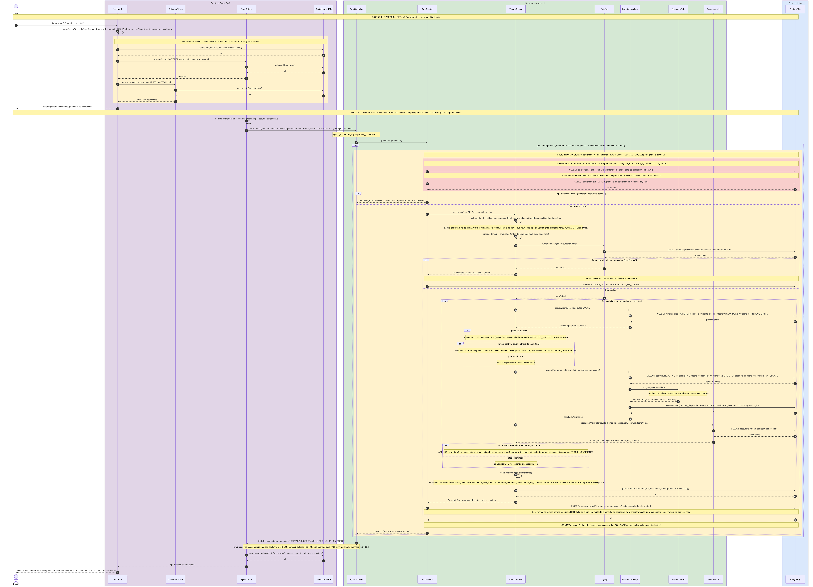
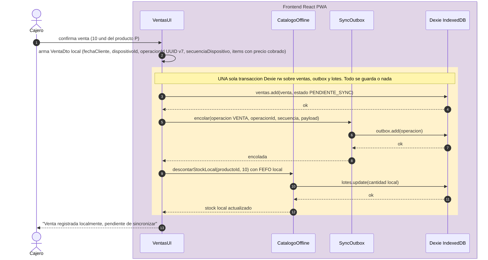
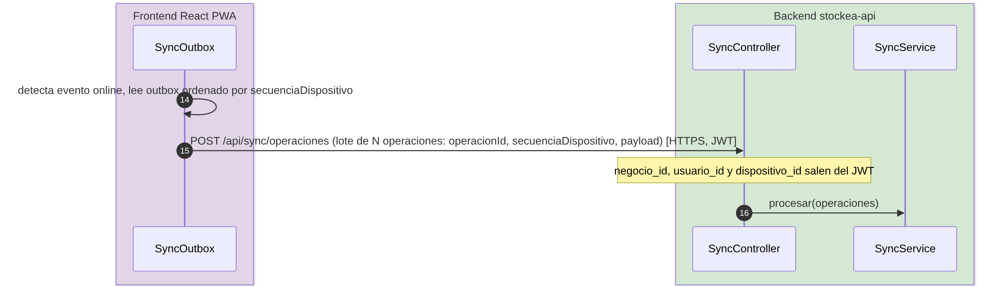
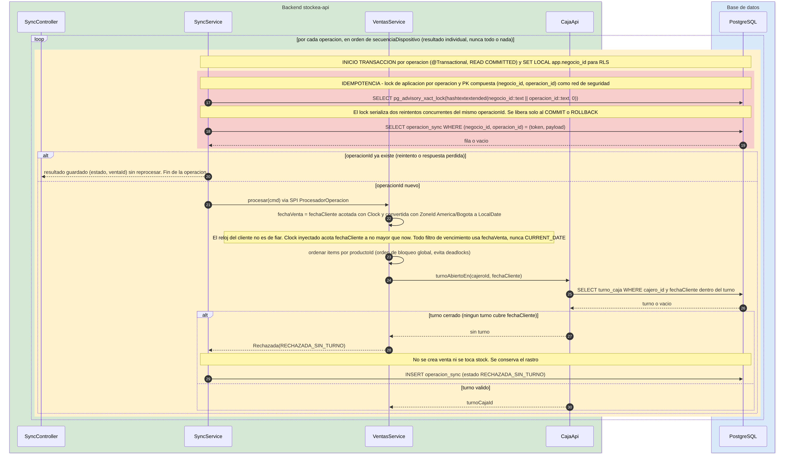
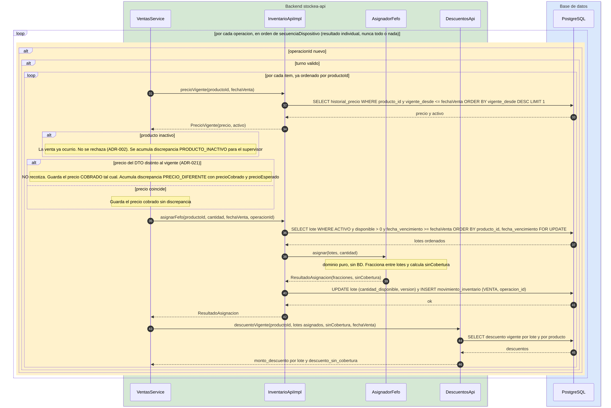
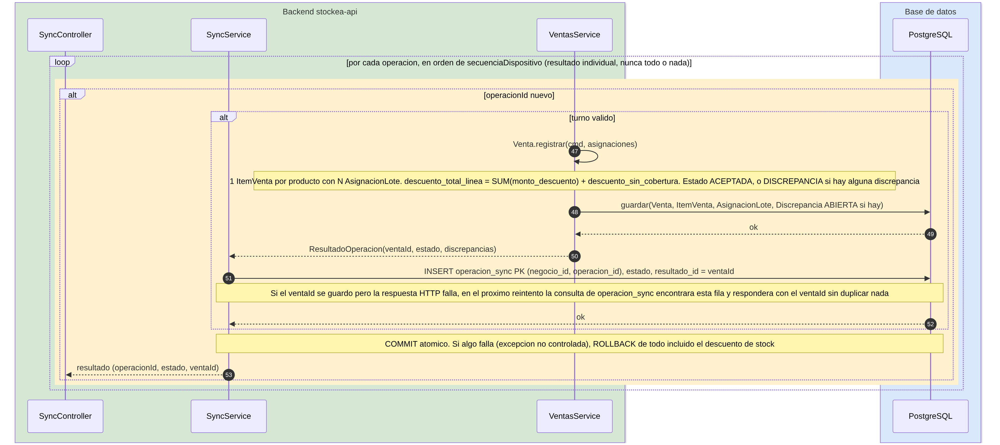
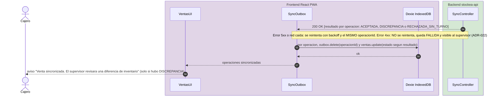

# Secuencia Offline y Sincronización — Registrar venta sin conexión

Muestra una venta hecha sin internet y su sincronización posterior, en dos bloques: la venta local, sin backend, y el envío del lote al volver la conexión. Es el diagrama donde se ve cómo se cumple que ninguna venta se pierde y ninguna se duplica.

> El diagrama completo tiene 58 pasos numerados. Cada momento de abajo es una captura del mismo diagrama con la numeración original, para leerlo sin hacer zoom.

## Momento 1: Bloque 1: la venta sin conexión

*Pasos 1–13 · Participantes: Cajero, VentasUI, CatalogoOffline, SyncOutbox, Dexie*

Sin internet, el backend no participa. Una transacción de Dexie escribe la venta, la encola en la outbox y descuenta el stock local con FEFO local, y el cajero ve "Venta registrada localmente, pendiente de sincronizar". Aquí nacen el `operacionId` (UUID v7) y la `secuenciaDispositivo`: el primero será la identidad de la operación y la segunda su orden, sin depender del reloj del dispositivo.

**Respaldo:** ADR-001 (offline-first, una sola transacción local) · ADR-002 (`operacion_id` y secuencia por dispositivo) · ESC-CAL-CON-0001

## Momento 2: Reconexión y envío del lote

*Pasos 14–16 · Participantes: SyncOutbox, SyncController, SyncService*

Al detectar el evento `online`, la outbox lee sus operaciones ordenadas por `secuenciaDispositivo` y las envía en un solo lote a `POST /api/sync/operaciones`, el **mismo endpoint** que usa el flujo online. El `negocio_id`, el `usuario_id` y el `dispositivo_id` salen del JWT. `SyncService` recibe el lote y procesa cada operación por separado.

**Respaldo:** ADR-001 (endpoint único; BackgroundSync solo como disparador oportunista) · ADR-008 (REST + outbox)

## Momento 3: Idempotencia y validaciones por operación

*Pasos 17–30 · Participantes: SyncController, SyncService, VentasService, CajaApi, PostgreSQL*

Cada operación del lote abre su propia transacción: toma el advisory lock sobre `(negocio_id, operacion_id)` y consulta `operacion_sync`. Si ya existe, devuelve el resultado guardado; si es nueva, calcula `fechaVenta` con `Clock` y `America/Bogota`, ordena los ítems y valida el turno contra `fechaCliente`. Que el turno se haya cerrado antes de sincronizar no invalida una venta hecha con el turno abierto.

**Respaldo:** ADR-002 (idempotencia, turno) · ADR-023 (`fechaVenta`) · ADR-022 (resultado por operación)

## Momento 4: Precio, FEFO y descuentos sobre el stock real

*Pasos 31–46 · Participantes: VentasService, InventarioApiImpl, AsignadorFefo, DescuentosApi, PostgreSQL*

Aquí se resuelve el conflicto entre dispositivos: el servidor ejecuta FEFO sobre el stock **real**, que otro dispositivo pudo haber consumido mientras este estaba offline. El precio cobrado se valida contra el vigente a `fechaVenta` sin recotizar, y si el stock no alcanza, la venta se acepta igual con `cantidad_sin_cobertura` y una discrepancia. El orden de bloqueo `(producto_id, fecha_vencimiento)` evita interbloqueos entre sincronizaciones concurrentes.

**Respaldo:** ADR-002 (venta siempre aceptada) · ADR-003 y ADR-009 (FEFO puro) · ADR-021 (autoridad del precio)

## Momento 5: Persistencia y COMMIT por operación

*Pasos 47–53 · Participantes: SyncService, VentasService, SyncController, PostgreSQL*

Se guardan la venta, las asignaciones, las discrepancias y la fila de `operacion_sync` en un solo `COMMIT` por operación; una operación con discrepancia no bloquea a las siguientes. Si el `ventaId` se guardó pero la respuesta HTTP se perdió, el reintento encuentra la fila en `operacion_sync` y devuelve el mismo `ventaId` sin duplicar nada.

**Respaldo:** ADR-002 (idempotencia, resultado por operación) · ADR-009 (transacción de aplicación)

## Momento 6: Respuesta y limpieza de la cola

*Pasos 54–58 · Participantes: SyncController, SyncOutbox, Dexie, VentasUI, Cajero*

El backend responde `200 OK` con un resultado por operación, nunca "todo o nada". La outbox borra de la cola las operaciones procesadas y actualiza el estado de cada venta local; si hubo discrepancia, el cajero recibe el aviso de que el supervisor revisará una diferencia de inventario. Los errores 5xx se reintentan con el mismo `operacion_id` y los 4xx quedan como `FALLIDA`.

**Respaldo:** ADR-022 (política de errores de la outbox) · ADR-002 (respuesta por operación)
