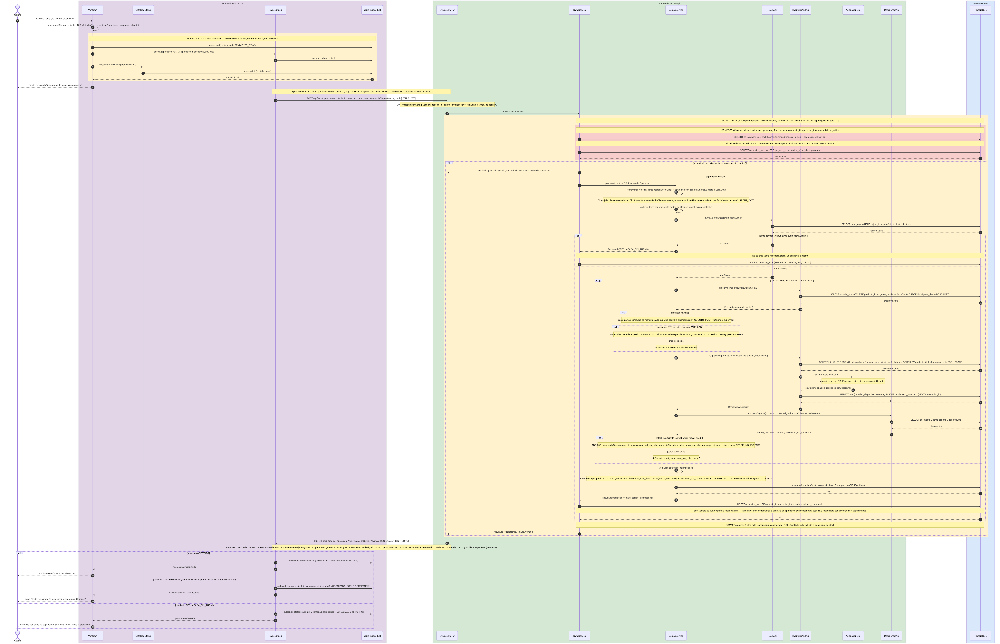
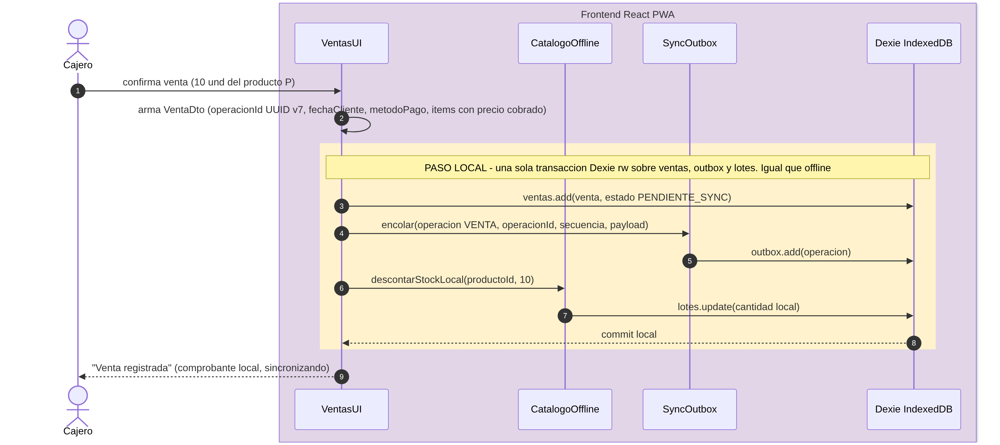
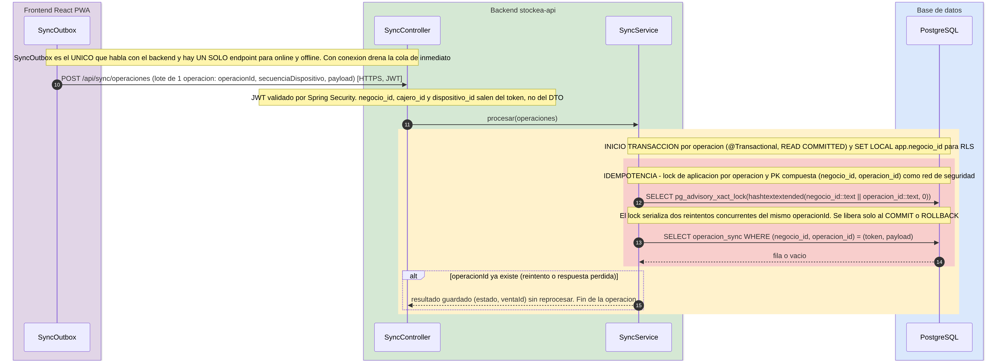
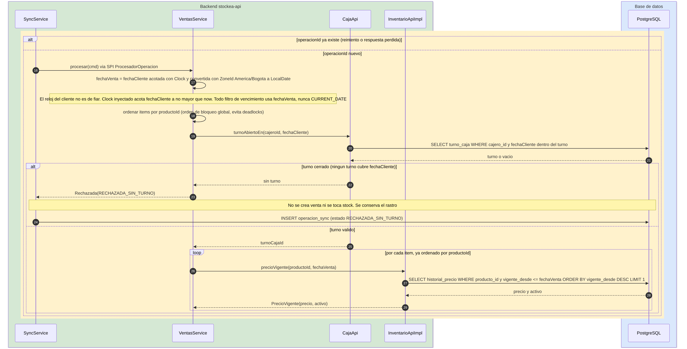
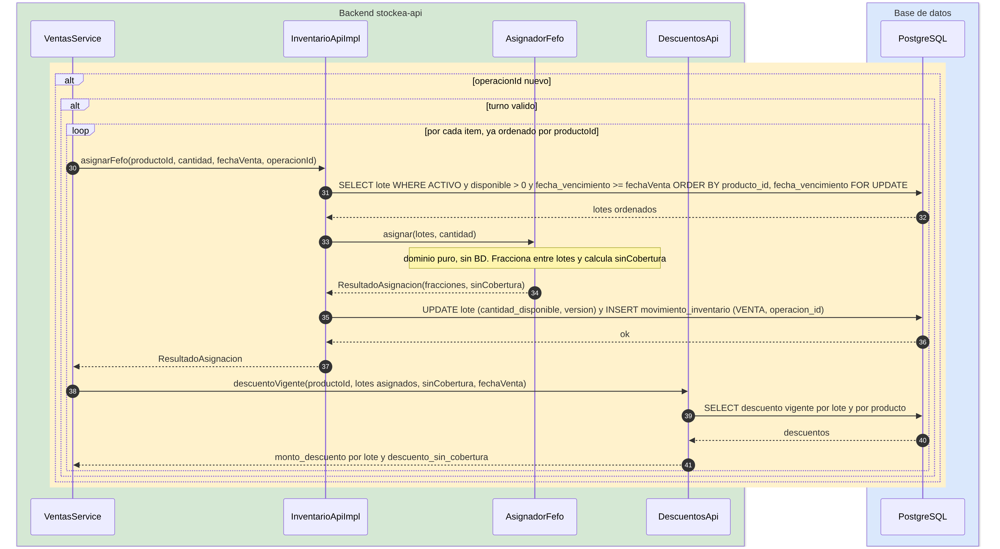
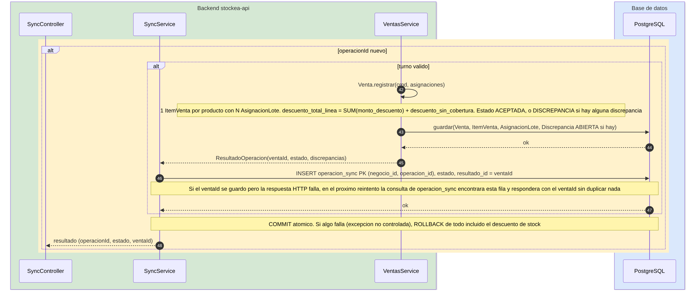
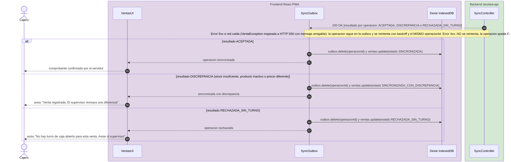

# Secuencia Online — Registrar venta con conexión

Muestra cómo se registra una venta cuando hay internet. El camino es el mismo que sin conexión: la venta se escribe primero en Dexie y la outbox la envía al único endpoint `/api/sync/operaciones`; solo cambia que la cola se vacía de inmediato.

> El diagrama completo tiene 58 pasos numerados. Cada momento de abajo es una captura del mismo diagrama con la numeración original, para leerlo sin hacer zoom.

## Momento 1: Paso local en Dexie

*Pasos 1–9 · Participantes: Cajero, VentasUI, CatalogoOffline, SyncOutbox, Dexie*

El cajero confirma la venta y la interfaz arma el `VentaDto` con un `operacionId` UUID v7, la `fechaCliente` y el precio cobrado. Una sola transacción de Dexie escribe la venta, la entrada de la outbox y el descuento de stock local: o se guardan las tres cosas o ninguna. El cajero ve "Venta registrada" sin haber tocado la red, así que el tiempo percibido no depende del servidor.

**Respaldo:** ADR-001 (offline-first siempre, `durability: strict`) · ESC-CAL-CON-0001 · ESC-CAL-REN-0021

## Momento 2: Envío al backend e idempotencia

*Pasos 10–15 · Participantes: SyncOutbox, SyncController, SyncService, PostgreSQL*

`SyncOutbox`, el único componente que habla con el backend, envía `POST /api/sync/operaciones` con un lote de una operación; el `negocio_id` y el `cajero_id` salen del JWT, no del cuerpo. Al abrir la transacción, `SyncService` toma un `pg_advisory_xact_lock` sobre el hash de `(negocio_id, operacion_id)` y consulta `operacion_sync`. Si la operación ya existe, devuelve el resultado guardado y termina (paso 15) sin reprocesar nada.

**Respaldo:** ADR-001 (endpoint único, no existe `POST /api/ventas`) · ADR-002 (PK compuesta + advisory lock, READ COMMITTED)

## Momento 3: Validaciones previas: fecha, turno y precio

*Pasos 16–29 · Participantes: SyncService, VentasService, CajaApi, InventarioApiImpl, PostgreSQL*

Para una operación nueva, `VentasService` calcula `fechaVenta` acotando `fechaCliente` con el `Clock` y convirtiéndola a `America/Bogota`, y ordena los ítems por `productoId` para tener un orden de bloqueo global. Valida que haya un turno abierto a `fechaCliente`: si no lo hay, se registra `RECHAZADA_SIN_TURNO` y no se crea venta. Después, por cada ítem, consulta el precio vigente a `fechaVenta` en `historial_precio`; si difiere del cobrado, **no recotiza**: guarda lo cobrado y acumula una discrepancia.

**Respaldo:** ADR-023 (`fechaVenta`, `Clock`, `ZoneId`) · ADR-002 (turno cerrado como única excepción) · ADR-021 (el servidor no recotiza)

## Momento 4: Asignación FEFO, descuentos y stock

*Pasos 30–41 · Participantes: VentasService, InventarioApiImpl, AsignadorFefo, DescuentosApi, PostgreSQL*

`InventarioApiImpl` consulta los lotes con `SELECT ... ORDER BY producto_id, fecha_vencimiento FOR UPDATE` filtrando `fecha_vencimiento >= fechaVenta`, y se los pasa a `AsignadorFefo`, que es dominio puro y no toca la base de datos. El resultado se descuenta con `UPDATE lote` más un `movimiento_inventario`, y `DescuentosApi` calcula el descuento por lote y el `descuento_sin_cobertura`. Si ningún lote alcanza, la venta no se rechaza: se registra `cantidad_sin_cobertura` y una discrepancia.

**Respaldo:** ADR-003 (FEFO, descuento por `AsignacionLote`) · ADR-009 (`AsignadorFefo` sin acceso a datos) · ADR-002 (stock nunca negativo)

## Momento 5: Persistencia y COMMIT

*Pasos 42–48 · Participantes: SyncService, VentasService, SyncController, PostgreSQL*

`Venta.registrar` arma un `ItemVenta` por producto con sus `AsignacionLote`, calcula totales y decide el estado: `ACEPTADA`, o `DISCREPANCIA` si hubo alguna. La venta, las asignaciones, las discrepancias y la fila de `operacion_sync` se guardan **dentro de la misma transacción**, y un solo `COMMIT` las confirma. Si algo falla, el `ROLLBACK` revierte también el descuento de stock y el reintento con el mismo `operacion_id` es seguro.

**Respaldo:** ADR-009 (transacción abierta por el servicio de aplicación) · ADR-002 (`operacion_sync` en la misma transacción)

## Momento 6: Respuesta al cliente

*Pasos 49–58 · Participantes: SyncController, SyncOutbox, VentasUI, Dexie, Cajero*

El backend responde `200 OK` con el resultado por operación. La outbox borra la operación de la cola y actualiza la venta local según el resultado: sincronizada, sincronizada con discrepancia o rechazada sin turno, cada una con su mensaje al cajero. Un 5xx o una red caída no borra nada y se reintenta con backoff y el mismo `operacion_id`; un 4xx no se reintenta y queda como `FALLIDA` y visible al supervisor.

**Respaldo:** ADR-022 (5xx reintenta, 4xx no; las reglas de negocio viajan dentro del 200) · ADR-002
